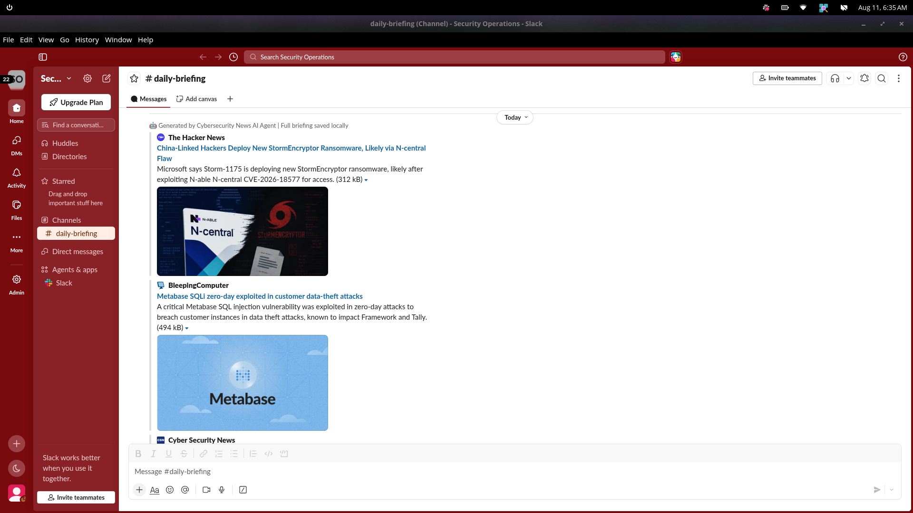
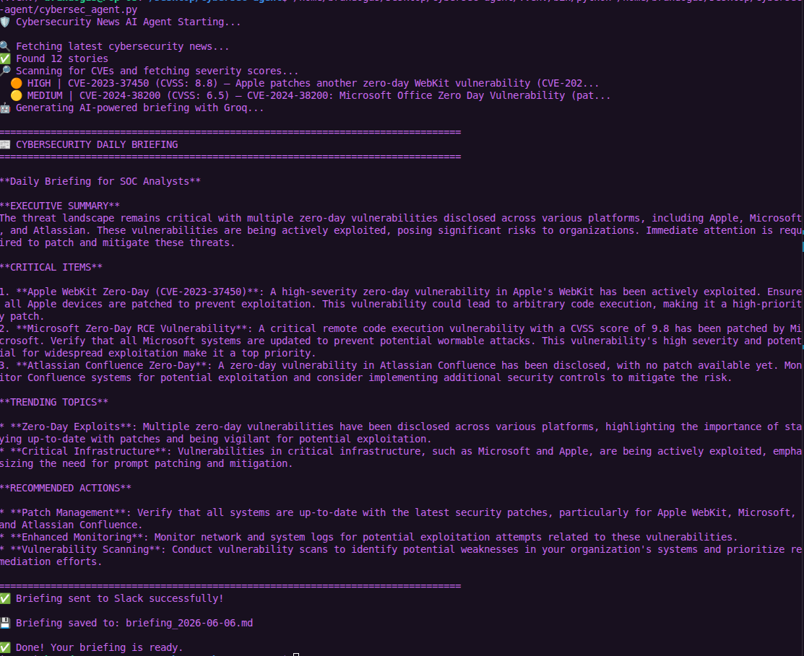

# Cybersecurity News AI Agent

This project automatically gathers cybersecurity news, prioritizes the most relevant stories for a SOC workflow, enriches them with CVE severity data, extracts indicators of compromise, and generates a daily briefing. It can print the briefing locally, save markdown and HTML reports, and deliver the result to Slack, email, or Discord.

## What it does

- Aggregates stories from Hacker News security searches and RSS feeds
- Deduplicates and scores stories by engagement, recency, keyword relevance, and CVE impact
- Enriches CVEs with CISA KEV, EPSS and NVD data, showing `unknown` instead of guessing when a source is unavailable
- Flags stories that affect the products on your watchlist
- Extracts common IOCs from story titles and URLs, including IPv4s, domains, MD5, SHA256, and CVE IDs
- Saves daily briefing reports in markdown and HTML format
- Sends the briefing to Slack, email, or Discord when configured
- Supports scheduler generation for systemd and cron-based automation

## Core features

- AI-powered briefing generation with Groq using a SOC-focused prompt
- Automatic fallback to a basic briefing when `GROQ_API_KEY` is missing or `--no-ai` is used
- Daily archive folders under the configured output directory
- Optional scheduler file generation via environment variables
- CLI switches for output directory, story count, saving, AI generation, and print-only mode

## Repository layout

- `cybersec_agent.py` — main application and CLI entry point
- `enrichment.py` — CISA KEV, EPSS and NVD lookups with an on-disk cache
- `watchlist.py` — watchlist loading and matching
- `tests/` — offline unit tests (the network is faked; no internet needed)
- `output/briefings/` — generated markdown and HTML briefing files
- `output/ioc_watchlists/` — IOC watchlist files grouped by date
- `systemd/` — sample systemd service unit
- `cybersec-agent.cron` — sample cron entry

## Screenshots






## Prerequisites

- Linux or another Unix-like environment
- Python 3.8+
- Internet access for fetching feeds and NVD data
- Optional: Groq API key for AI-generated summaries
- Optional: Slack webhook URL, Discord webhook URL, or SMTP credentials for delivery

## Quick start

1. Clone the repository:

```bash
git clone https://github.com/Alchemy-Paul/Cybersecurity-News-AI-Agent.git cybersec-agent
cd cybersec-agent
```

2. Copy the sample environment file and fill in the values you need:

```bash
cp .env.example .env
nano .env
```

Example settings:

```env
GROQ_API_KEY=your_groq_api_key_here
SLACK_WEBHOOK_URL=<your-slack-webhook-url>
OUTPUT_DIR=/absolute/path/to/output
MAX_STORY_COUNT=12
GROQ_MODEL=meta-llama/llama-4-scout-17b-16e-instruct
GROQ_ENDPOINT=https://api.groq.com/openai/v1/chat/completions
CRON_SCHEDULE=0 8 * * *
GENERATE_SCHEDULER_FILES=0

SMTP_HOST=
SMTP_PORT=587
SMTP_USER=
SMTP_PASSWORD=
SMTP_FROM=
SMTP_TO=

DISCORD_WEBHOOK_URL=
```

3. Create and activate a virtual environment:

```bash
python3 -m venv .venv
source .venv/bin/activate
```

4. Install dependencies:

```bash
pip install -r requirements.txt
```

5. Run the agent:

```bash
.venv/bin/python cybersec_agent.py
```

If `GROQ_API_KEY` is not set, the script falls back to a basic briefing automatically. You can also force the text-only fallback with `--no-ai`.

## Vulnerability enrichment and "affects our stack"

CVEs found in a story's title or summary are enriched from authoritative sources instead of guessed from the headline:

- **CISA KEV** - is the CVE confirmed exploited in the wild (and used in ransomware)?
- **FIRST EPSS** - probability of exploitation in the next 30 days
- **NVD** - CVSS base score and the affected vendors/products

Stories are ranked KEV first, then EPSS and CVSS, then everything else. Results are cached under `output/cache/`.

If a source is unreachable the field is shown as `unknown` (never invented). In particular, `KEV: unknown` means the feed could not be checked, which is not the same as "not exploited". Without NVD data, severity is `unknown`; a headline-based hint may be shown but is labelled unverified.

**Watchlist.** Copy `watchlist.example.txt` to `watchlist.txt` and list the vendors/products you run. Stories that mention them, or whose CVEs affect them (via NVD CPE or KEV data), are flagged **Affects Our Stack**, placed in their own briefing section and ranked above everything else. Use specific terms ("microsoft exchange", not "exchange").

Set `NVD_API_KEY` (free) to raise the NVD rate limit. Use `--no-enrich` to skip all lookups, or `--watchlist PATH` to use another file.

## Runtime options

```bash
.venv/bin/python cybersec_agent.py --output-dir output --max-stories 8
.venv/bin/python cybersec_agent.py --no-slack
.venv/bin/python cybersec_agent.py --no-save
.venv/bin/python cybersec_agent.py --print-only
.venv/bin/python cybersec_agent.py --no-ai
```

Command-line flags:

- `--output-dir`: Set the output directory for generated briefing and IOC files
- `--max-stories`: Limit the number of stories included in the briefing
- `--no-slack`: Disable Slack delivery
- `--no-save`: Skip writing reports to disk
- `--print-only`: Print the briefing to the terminal without saving or sending it
- `--no-ai`: Disable Groq and use the basic briefing generator instead
- `--no-enrich`: Skip KEV / EPSS / NVD lookups (CVE severity will be unknown)
- `--watchlist`: Path to your watchlist file (default `watchlist.txt` or `WATCHLIST_FILE`)

## Output artifacts

The script creates these folders automatically when needed:

- `output/briefings/` — markdown and HTML briefing reports named like `briefing_YYYY-MM-DD.md` and `briefing_YYYY-MM-DD.html`
- `output/ioc_watchlists/` — IOC watchlist text files named like `ioc_watchlist_YYYY-MM-DD.txt`

Each run also prints a summary of extracted IOCs and the final output paths.

## Environment variables

The application reads the following variables from the environment or a `.env` file:

- `GROQ_API_KEY`
- `SLACK_WEBHOOK_URL`
- `OUTPUT_DIR`
- `MAX_STORY_COUNT`
- `GROQ_MODEL`
- `GROQ_ENDPOINT`
- `SMTP_HOST`
- `SMTP_PORT`
- `SMTP_USER`
- `SMTP_PASSWORD`
- `SMTP_FROM`
- `SMTP_TO`
- `DISCORD_WEBHOOK_URL`
- `CRON_SCHEDULE`
- `GENERATE_SCHEDULER_FILES`

These control the AI model, output location, delivery channels, and scheduler generation behavior.

## Scheduler setup

You can generate sample cron and systemd files automatically:

```bash
GENERATE_SCHEDULER_FILES=1 .venv/bin/python cybersec_agent.py
```

This writes sample files to the configured output directory, including:

- `systemd/cybersec-agent.service`
- `cybersec-agent.cron`

Example systemd activation:

```bash
sudo cp systemd/cybersec-agent.service /etc/systemd/system/
sudo systemctl daemon-reload
sudo systemctl enable --now cybersec-agent.service
```

Example cron entry:

```bash
crontab -e
```

Add a line similar to:

```bash
0 8 * * * /home/youruser/cybersec-agent/.venv/bin/python /home/youruser/cybersec-agent/cybersec_agent.py --output-dir /home/youruser/cybersec-agent/output --no-slack > /home/youruser/cybersec-agent/output/cron.log 2>&1
```

## Notes

- The script automatically creates the output folders if they do not already exist.
- Story prioritization is based on keyword relevance, age, engagement, and detected CVE severity.
- When a CVE cannot be fetched from NVD, the agent assigns a heuristic severity tag to keep the briefing useful even during upstream issues.
- The project includes a small unittest suite to verify sanitization, prompt structure, scoring behavior, and CVE fallback logic.
