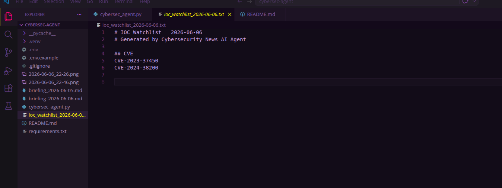

# Cybersecurity News Evidence Briefing Agent

This project automatically gathers cybersecurity news, prioritizes stories for a SOC workflow, enriches CVEs, extracts potential indicators, and generates a source-grounded daily evidence briefing. It can print the briefing locally, save markdown and HTML reports, and deliver the result to Slack, email, or Discord.

## What it does

- Aggregates newly added CISA KEV entries and Microsoft, Cisco, and Fortinet advisories, with Hacker News and security-news RSS feeds as supplementary coverage
- Retries transient feed and vulnerability-lookup request failures up to three attempts with exponential backoff, and reports operational status through Python logging
- Groups closely related headlines, preserves their source coverage, and scores stories by engagement, known recency, keyword relevance, and CVE impact
- Enriches CVEs with CISA KEV, EPSS and NVD data, showing `unknown` instead of guessing when a source is unavailable
- Flags possible watchlist matches without claiming that the product is deployed or affected
- Extracts common IOCs from story titles and URLs, including IPv4s, domains, MD5, SHA256, and CVE IDs
- Saves daily briefing reports in markdown and HTML format
- Sends the briefing to Slack, email, or Discord when configured
- Supports scheduler generation for systemd and cron-based automation

## News sources

CISA's Known Exploited Vulnerabilities (KEV) catalog is a primary source. Each run includes up to 12 of its most recently added entries. Vendor advisory feeds are provided by the Microsoft Security Response Center, Cisco Security Advisories, and Fortinet PSIRT. Supplementary coverage comes from one Hacker News security search and RSS feeds from Cybersecurity News, The Hacker News, BleepingComputer, and Securelist.

Feed and enrichment HTTP requests are tried up to three times total. Between attempts, the agent waits 1 second and then 2 seconds. If all attempts fail, the failure is logged and processing continues with the remaining sources; unavailable enrichment remains unknown rather than being inferred. When run from the command line, the agent configures INFO-level logging. The briefing itself is still printed to the terminal.

## Core features

- Deterministic evidence reporting from fetched stories and structured CVE enrichment
- Optional Groq AI triage questions, constrained to valid story citations and checked against enriched CVE IDs, CVSS scores, and severity; AI output remains separate from verified data and is labeled as unverified hypotheses, not remediation advice
- Publisher headlines and summaries are attributed to their source; CVE enrichment includes direct links to official records and identifies unavailable data
- Date-named briefing and IOC files under the configured output directory; another run on the same day replaces those files
- Optional scheduler file generation via environment variables
- CLI switches for output directory, story count, saving, and print-only mode

## Repository layout

- `cybersec_agent.py` — main application and CLI entry point
- `enrichment.py` — CISA KEV, EPSS and NVD lookups with an on-disk cache
- `watchlist.py` — watchlist loading and matching
- `tests/` — offline unit tests (the network is faked; no internet needed)
- `docs/screenshots/` — project screenshots
- `systemd/` — sample systemd service unit
- `cybersec-agent.cron` — sample cron entry

## Screenshots




## Prerequisites

- Linux or another Unix-like environment
- Python 3.8+
- Internet access for fetching feeds and NVD data
- Optional: Groq API key for AI-generated triage questions
- Optional: Slack webhook URL, Discord webhook URL, or SMTP credentials for delivery

## Quick start

1. Clone the repository:

```bash
git clone https://github.com/Alchemy-Paul/Cybersecurity-News-AI-Agent.git cybersec-agent
cd cybersec-agent
```

2. Copy the sample environment file and fill in the values you need:

```bash
cp .env.example .env
nano .env
```

Example settings:

```env
GROQ_API_KEY=your_groq_api_key_here
GROQ_MODEL=openai/gpt-oss-120b
GROQ_ENDPOINT=https://api.groq.com/openai/v1/chat/completions
SLACK_WEBHOOK_URL=<your-slack-webhook-url>
OUTPUT_DIR=/absolute/path/to/output
MAX_STORY_COUNT=12
CRON_SCHEDULE=0 8 * * *
GENERATE_SCHEDULER_FILES=0

SMTP_HOST=
SMTP_PORT=587
SMTP_USER=
SMTP_PASSWORD=
SMTP_FROM=
SMTP_TO=

DISCORD_WEBHOOK_URL=
```

3. Create and activate a virtual environment:

```bash
python3 -m venv .venv
source .venv/bin/activate
```

4. Install dependencies:

```bash
pip install -r requirements.txt
```

5. Run the agent:

```bash
.venv/bin/python cybersec_agent.py
```

The report’s evidence section is deterministic. If `GROQ_API_KEY` is configured, Groq may add a clearly separated section of AI-generated triage questions with validated story citations. Publisher-provided text is treated as untrusted input, and generated questions containing CVE IDs, severity labels, or CVSS scores absent from that story’s enrichment are rejected. The questions remain separate from verified CVE data and are hypotheses, not confirmed findings or remediation instructions. If no key is configured or the API fails, the evidence briefing is still generated without AI questions.

## Vulnerability enrichment and "affects our stack"

CVEs found in a story's title or summary are enriched from authoritative sources instead of guessed from the headline:

- **CISA KEV** - is the CVE confirmed exploited in the wild (and used in ransomware)?
- **FIRST EPSS** - probability of exploitation in the next 30 days
- **NVD** - CVSS base score and the affected vendors/products

Stories are sorted by a weighted relevance score. Watchlist matches and KEV-listed CVEs receive large boosts; CVE presence, EPSS, CVSS severity, recency, keywords, and (for Hacker News) engagement also contribute. This is prioritization, not a strict severity ordering. Results are cached under `<output-dir>/cache/`.

If a source is unreachable the field is shown as `unknown` (never invented). In particular, `KEV: unknown` means the feed could not be checked, which is not the same as "not exploited". Without NVD data, severity is `unknown`; a headline-based hint may be shown but is labelled unverified.

**Watchlist.** Copy `watchlist.example.txt` to `watchlist.txt` and list the vendors/products you run. Stories that mention them, or whose CVEs affect them (via NVD CPE or KEV data), are marked as possible matches and ranked higher. A match is not confirmation that a product is deployed or affected. Use specific terms ("microsoft exchange", not "exchange").

Set `NVD_API_KEY` (free) to raise the NVD rate limit. Use `--no-enrich` to skip all lookups, or `--watchlist PATH` to use another file.

## Runtime options

```bash
.venv/bin/python cybersec_agent.py --output-dir output --max-stories 8
.venv/bin/python cybersec_agent.py --no-slack
.venv/bin/python cybersec_agent.py --no-save
.venv/bin/python cybersec_agent.py --print-only
```

Command-line flags:

- `--help`: Show the available options and exit
- `--output-dir`: Set the output directory for generated briefing and IOC files
- `--max-stories`: Limit the number of stories included in the briefing
- `--no-slack`: Disable Slack delivery
- `--no-save`: Skip writing briefing, HTML, and IOC report files; enrichment cache data may still be written
- `--print-only`: Print the briefing without saving reports or sending it to Slack, email, or Discord
- `--no-enrich`: Skip KEV / EPSS / NVD lookups (CVE severity will be unknown)
- `--watchlist`: Path to your watchlist file (default `watchlist.txt` or `WATCHLIST_FILE`)

`--no-slack` disables only Slack delivery. Email and Discord are sent when their required settings are configured, unless `--print-only` is set.

## Output artifacts

The script creates these folders automatically when needed:

- `output/briefings/` — markdown and HTML briefing reports named like `briefing_YYYY-MM-DD.md` and `briefing_YYYY-MM-DD.html`
- `output/ioc_watchlists/` — candidate IOC reference files extracted from news titles and URLs; validate them before detection or blocking use

Each run logs a summary of extracted IOCs and the final output paths.

## Environment variables

The application reads the following variables from the environment or a `.env` file:

- `SLACK_WEBHOOK_URL`
- `GROQ_API_KEY`
- `GROQ_MODEL`
- `GROQ_ENDPOINT`
- `OUTPUT_DIR`
- `MAX_STORY_COUNT`
- `SMTP_HOST`
- `SMTP_PORT`
- `SMTP_USER`
- `SMTP_PASSWORD`
- `SMTP_FROM`
- `SMTP_TO`
- `DISCORD_WEBHOOK_URL`
- `NVD_API_KEY`
- `WATCHLIST_FILE`
- `CRON_SCHEDULE`
- `GENERATE_SCHEDULER_FILES`

These control the AI triage endpoint, output location, delivery channels, vulnerability lookups, watchlist path, and scheduler generation behavior.

## Scheduler setup

You can generate sample cron and systemd files automatically:

```bash
OUTPUT_DIR=/path/to/cybersec-agent \
GENERATE_SCHEDULER_FILES=1 .venv/bin/python cybersec_agent.py --output-dir /path/to/cybersec-agent
```

This writes files to the configured output directory:

- `systemd/cybersec-agent.service`
- `cybersec-agent.cron`

The generated service and cron entry assume `cybersec_agent.py` is in the configured output directory. Set that directory to your project checkout (the directory containing the script), or edit the generated paths to point to your checkout before activating them.

Example systemd activation after reviewing the generated service:

```bash
sudo cp /path/to/cybersec-agent/systemd/cybersec-agent.service /etc/systemd/system/
sudo systemctl daemon-reload
sudo systemctl enable --now cybersec-agent.service
```

Example cron entry:

The generated `cybersec-agent.cron` includes a username and is formatted for a system cron file such as `/etc/cron.d/cybersec-agent`. For `crontab -e`, use the user-crontab format below, without the username field.

```bash
crontab -e
```

Add a line similar to:

```bash
0 8 * * * /home/youruser/cybersec-agent/.venv/bin/python /home/youruser/cybersec-agent/cybersec_agent.py --output-dir /home/youruser/cybersec-agent/output --no-slack > /home/youruser/cybersec-agent/output/cron.log 2>&1
```

## Notes

- The script automatically creates the output folders if they do not already exist.
- Story prioritization uses a weighted score based on watchlist matches, KEV/EPSS/CVSS data, CVE presence, keyword relevance, age, and engagement.
- Closely related headlines are grouped into one story with contributing sources shown. Stories without a usable publication date are marked unknown and receive no freshness bonus.
- When CVSS data is unavailable, the report keeps the score unknown; any headline-based severity hint is explicitly labeled unverified.
- The project includes a small unittest suite to verify sanitization, evidence reporting, scoring behavior, and CVE fallback logic.
